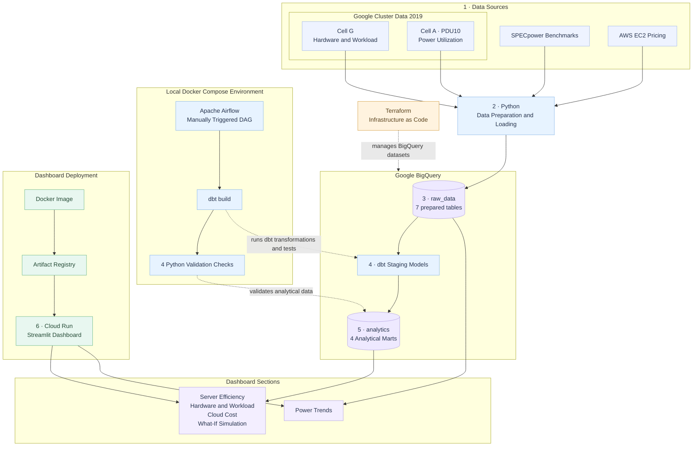

# Data Center Hardware & Energy Efficiency — System Architecture

This diagram shows the implemented data flow, local orchestration, and dashboard deployment. Numbered labels follow the main data path; Airflow and Terraform are shown as supporting components.

## Legend

| Style | Meaning |
|---|---|
| Blue | Data sources, preparation, and orchestration |
| Purple | BigQuery datasets and analytical models |
| Green | Dashboard container and Google Cloud deployment |
| Amber | Terraform-managed infrastructure |
| Solid arrow | Data movement or deployment flow |
| Dashed arrow | Orchestration, validation, or infrastructure management |

## Architecture Notes

- Python data preparation and loading run outside the current Airflow DAG.
- Cell A PDU10 power data and Cell G hardware and workload data are both part of Google Cluster Data 2019, but come from different cells and are not directly joined.
- BigQuery stores seven prepared source tables in `raw_data` and four analytical marts in `analytics`.
- The manually triggered Airflow DAG runs `dbt build`, followed by four Python validation checks.
- Airflow runs locally through Docker Compose.
- The Streamlit dashboard is deployed on Google Cloud Run.
- The dashboard's analytical sections query the marts; Power Trends reads cleaned Cell A power data directly from `raw_data`.
- Terraform currently manages the BigQuery datasets. Cloud Run and Artifact Registry are not managed by Terraform.
