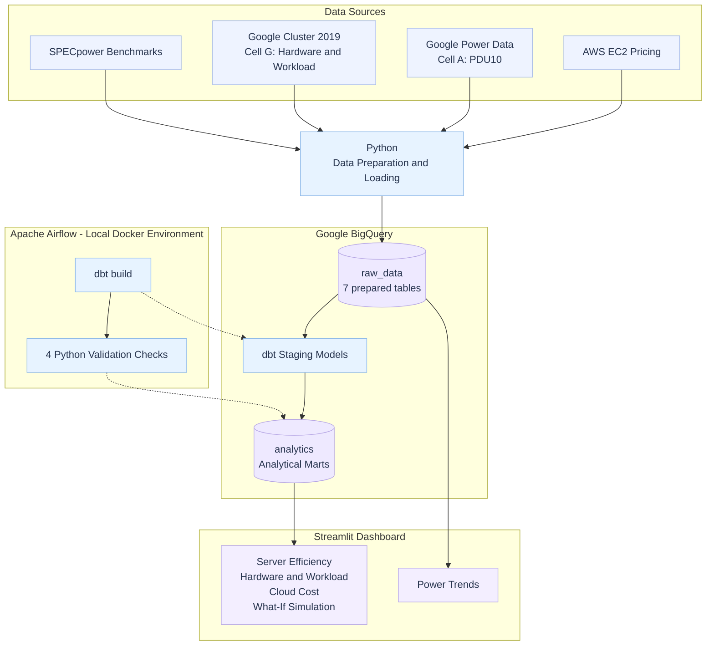

# Data Center Hardware & Energy Efficiency — System Architecture

This diagram represents the current implemented architecture.

## Architecture Notes

- Python data preparation and loading run outside the current Airflow DAG.
- BigQuery stores seven prepared source tables in `raw_data`.
- dbt builds staging models and analytical marts.
- Airflow runs `dbt build`, followed by four validation checks.
- The current DAG is manually triggered, not scheduled.
- Four Streamlit pages query analytical marts.
- Power Trends queries cleaned Cell A power data directly from `raw_data`.
- Google Cell A power and Cell G workload datasets are separate and must not be treated as directly joined.
- Terraform and Cloud Run are not shown as deployed components until their implementation is confirmed.

